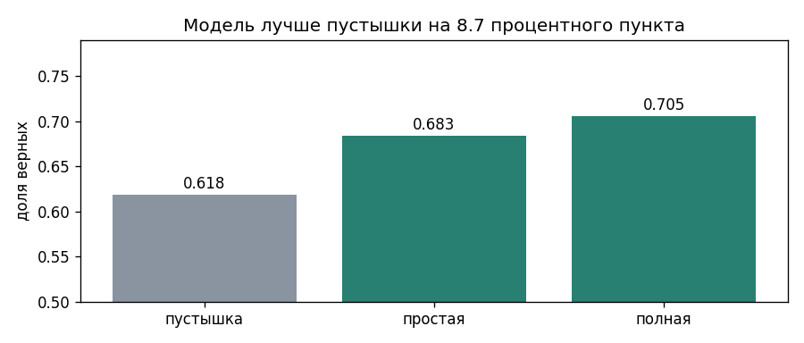

# Дойдёт ли участник гималайской экспедиции до вершины

**Задача.** По данным участника до начала экспедиции предсказать, дойдёт ли он до вершины (`success`): классификация, метрика доля верных ответов.

**Данные.** [Himalayan Database, участники экспедиций (TidyTuesday)](https://github.com/rfordatascience/tidytuesday/tree/main/data/2020/2020-09-22): 76 519 строк, 21 столбец, одна строка это один участник одной экспедиции.

## Что сделано с данными

| шаг | решение | строк |
|---|---|---|
| загрузка | members.csv из TidyTuesday | 76 519 |
| цель | success: True/False в 1/0 | 76 519 |
| дубли | полных дублей 0; 4 680 похожих строк без member_id оставлены: разные люди одной экспедиции | 76 519 |
| невозможное | 6 правил, 5 нарушений: редкие, но реальные случаи, оставлены | 76 519 |
| скрытые пропуски | сезон Unknown: 1 строка удалена | 76 518 |
| страны | Kyrgyz Republic объединён с Kyrgyzstan; двойное гражданство оставлено | 76 518 |
| пропуски | возраст: флаг age_missing и медиана; единичные: Unknown, M, peak_id; столбцы смерти и травм (98% пусто) удалены | 76 518 |
| типы | True/False в 1/0, возраст и высота в целые | 76 518 |
| выбросы | возраст старше 62 и годы до 1960 это реальные редкости, оставлены | 76 518 |

## Главное из EDA

* Доходят до вершины 38%, пустышка «никто не дойдёт» угадывает 61,8%.
* Чем старше участник, тем реже успех: до 25 лет 44%, после 55 лет 24%.
* Успех вырос с 18% до 1960 года до 50% после 2010 года.
* Весной успех 41%, зимой 24%.

## Утечка

Не беру `highpoint_metres`, `died` и `injured`: они известны только после экспедиции (с высотой доля верных 0,951). `oxygen_used` тоже не беру: с ним 0,773 вместо 0,705, а решение о кислороде часто принимают уже на горе.

## Результаты

| модель | доля верных |
|---|---|
| пустышка | 0,618 |
| простая модель (возраст, год, нанят) | 0,683 |
| полная модель | 0,705 |

На test: модель 0,709, пустышка 0,618. Модель лучше пустышки на 9,1 п.п.

## Выводы

1. Честная модель лучше пустышки на 9,1 п.п. на test.
2. Самые сильные честные сигналы: эпоха после 2000 года, гражданство Непала, весна и осень.
3. Утечки (высота, кислород) найдены проверкой моделью и убраны.
4. Кросс-валидация (0,705) и test (0,709) совпали: подготовка учится только на train.

## Как запустить

1. `pip install -r requirements.txt`
2. Открыть `project.ipynb` и выполнить все ячейки.
